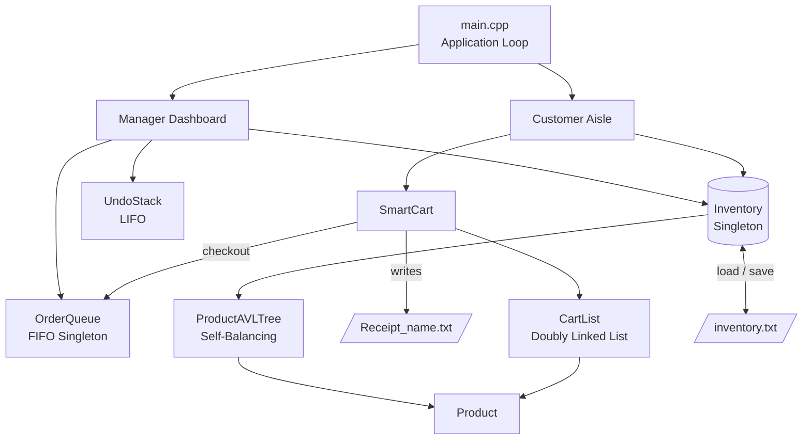

# ezbazar-smartcart
<div align="center">

# 🛒 EzBazar & SmartCart

### A Custom Data Structures E-Commerce Engine in C++

*Four hand-built data structures. One complete store. Zero STL containers doing the heavy lifting.*


[Overview](#-overview) •
[Features](#-features) •
[Data Structures](#-the-four-data-structures) •
[Architecture](#-architecture) •
[Getting Started](#-getting-started) •
[Walkthrough](#-how-to-use-it) •
[Team](#-team)

</div>

---

## 📖 Overview

**EzBazar** is a console-based online grocery and electronics store, and **SmartCart** is its shopping-cart engine. Together they simulate the full lifecycle of an e-commerce system: a store manager stocks the shelves, customers browse and fill their carts, checkouts flow into a dispatch pipeline, and the manager can process orders or undo mistakes.

What makes this project different is **how** it is built. Every core component is powered by a **custom data structure written from scratch**, with each structure chosen because it is the *natural* fit for the job, not just because it was required.

| Real-world need | Data structure chosen | Why it fits |
|---|---|---|
| Fast product lookup in a large catalog | **AVL Tree** | Guaranteed `O(log N)` search, insert and delete, even with sorted IDs |
| A cart that grows and shrinks constantly | **Doubly Linked List** | `O(1)` relinking on removal, no shifting or reallocation |
| First-come, first-served order dispatch | **FIFO Queue** | `O(1)` enqueue and dequeue, fairness by design |
| "Undo my last action" | **LIFO Stack** | Most recent action is reversed first, `O(1)` push and pop |

---

## ✨ Features

### 🧑‍💼 Store Manager
- 🔐 **Password-protected login** with 3 attempts
- 📦 **View master inventory** sorted by Product ID (AVL in-order traversal)
- ➕ **Add products** with validation (duplicate IDs rejected)
- ➖ **Remove products** with a backup snapshot taken automatically
- 🔢 **Change stock levels** in place, in `O(log N)`
- ↩️ **Undo** the last add, remove or stock change (LIFO)
- 📬 **Process pending orders** in strict first-in, first-out order

### 🛍️ Customer
- 🔎 **Browse the full catalog** and add items by Product ID and quantity
- 🏷️ **Filter by category** or **search by name keyword** (case-insensitive)
- 🧺 **SmartCart view** with per-item subtotals and a live grand total
- 🗑️ **Remove items**, with the reserved stock automatically returned to the shelf
- 💳 **Checkout** that enqueues the order and writes a **receipt file** (`Receipt_<name>.txt`)
- 🚪 **Leave store** safely: any unpurchased items are restored to inventory

### ⚙️ Under the Hood
- 💾 **File persistence** through `inventory.txt`, auto-seeded with 10 default products if the file is missing
- 🛡️ **Robust input validation** on every prompt (bad input never crashes the app)
- 🧠 **Stock reservation model**: stock is deducted when an item enters a cart and restored on removal or exit, so two customers can never oversell the same unit
- 🖥️ **Cross-platform** terminal helpers (`cls`/`clear`, `Sleep`/`usleep`)

---

## 🧱 The Four Data Structures

Every structure below is implemented manually with raw nodes and pointers, including constructors, destructors and memory cleanup.

### 1️⃣ Self-Balancing AVL Tree → Inventory
**File:** [`AVLTree.h`](AVLTree.h)

The inventory file stores IDs in sorted order (101, 102, 103…). A normal BST would degenerate into a linked list on that input. The AVL tree tracks every node's `height`, computes the **Balance Factor** (`height(left) - height(right)`), and performs **LL, RR, LR and RL rotations** whenever it leaves the range `[-1, +1]`.

```
        y                               x
       / \     Right Rotate (y)        / \
      x   T3   --------------->      T1   y
     / \                                 / \
   T1   T2                             T2   T3
```

Supports insert, remove (including the two-children in-order successor case), search, direct in-place pointer lookup for stock updates, and sorted export via in-order traversal. Memory is freed by post-order traversal in the destructor.

### 2️⃣ Doubly Linked List → SmartCart
**File:** [`CartList.h`](CartList.h)

Each node holds a `Product` plus `next` and `prev` pointers, with `head` and `tail` tracked for `O(1)` tail insertion. Adding an item that is already in the cart **increments its `cartQuantity`** instead of creating a duplicate node. Removing a node from anywhere relinks its neighbors directly through `prev` and `next`. The class follows the **Rule of Three** (copy constructor, copy assignment, destructor) for safe deep copying.

### 3️⃣ FIFO Queue → Order Processing
**File:** [`OrderQueue.h`](OrderQueue.h)

Maintains both a `frontNode` and a `rearNode`, so enqueue and dequeue are each `O(1)` with no traversal. Order IDs auto-increment from **#1001**. It is a **Singleton**, so the customer checkout flow and the manager dashboard share the exact same queue instance.

### 4️⃣ LIFO Stack → Manager Undo
**File:** [`UndoStack.h`](UndoStack.h)

Each `Action` stores its type (`ACTION_ADD_PRODUCT`, `ACTION_REMOVE_PRODUCT`, `ACTION_CHANGE_STOCK`), a snapshot of the affected product, and the old and new stock values, which is everything needed to reverse the operation exactly.

---

## ⏱️ Complexity at a Glance

| Operation | Structure | Time Complexity |
|---|---|---|
| Add / update product | AVL Tree | `O(log N)` |
| Remove product | AVL Tree | `O(log N)` |
| Search product by ID | AVL Tree | `O(log N)` |
| Change / reserve / restore stock | AVL Tree (in-place) | `O(log N)` |
| AVL rotation | AVL Tree | `O(1)` |
| List all products sorted | AVL Tree (in-order) | `O(N)` |
| Filter by category / search by name | AVL traversal | `O(N)` |
| Add item to cart (new node at tail) | Doubly Linked List | `O(1)` |
| Add item to cart (duplicate check first) | Doubly Linked List | `O(N)` |
| Remove item from cart (relink once found) | Doubly Linked List | `O(1)` relink, `O(N)` to locate |
| Enqueue order | FIFO Queue | `O(1)` |
| Dequeue order | FIFO Queue | `O(1)` |
| Push undo action | LIFO Stack | `O(1)` |
| Pop / undo action | LIFO Stack | `O(1)` |

---

## 🏗️ Architecture



### Object-Oriented Design Highlights
- **Abstraction and polymorphism:** `User` is an abstract base class with a pure virtual `displayDashboard()`, overridden by `Manager` and `Customer`
- **Singleton pattern:** `Inventory` and `OrderQueue` guarantee one shared instance across all flows
- **Encapsulation:** `Product` exposes `const`-qualified getters and validating setters (stock can never go negative)
- **Memory safety:** every structure frees its nodes in its destructor, and copy operations are deleted where shallow copying would be dangerous
- **Separation of concerns:** declarations in `.h`, implementations in `.cpp`, with each data structure in its own header

---

## 📁 Project Structure

```
EzBazar-SmartCart/
├── main.cpp          # Application entry point: menus and control flow
├── Product.h/.cpp    # Product entity (stock + cart quantity)
├── AVLTree.h         # Data Structure #1: self-balancing AVL tree
├── CartList.h        # Data Structure #2: doubly linked list
├── OrderQueue.h      # Data Structure #3: FIFO queue (+ Order struct)
├── UndoStack.h       # Data Structure #4: LIFO stack (+ Action struct)
├── Inventory.h/.cpp  # Singleton inventory manager backed by the AVL tree
├── SmartCart.h/.cpp  # Customer cart + checkout and receipt generation
├── User.h/.cpp       # Abstract User, Manager and Customer classes
├── Utils.h           # Cross-platform terminal helpers
└── inventory.txt     # Persistent product database
```

---

## 🚀 Getting Started

### Prerequisites
- A C++ compiler with C++11 support (**g++**, **clang++**, or **MinGW** on Windows)

### Clone the repository
```bash
git clone https://github.com/<your-username>/ezbazar-smartcart.git
cd ezbazar-smartcart
```

### Build
```bash
g++ -std=c++11 -Wall -o ezbazar *.cpp
```

### Run
```bash
# Linux / macOS
./ezbazar

# Windows
ezbazar.exe
```

> 💡 **Tip:** Run the program from the folder that contains `inventory.txt`. If the file is missing, EzBazar automatically creates it and seeds a default catalog of 10 products.

---

## 🎮 How to Use It

### Main Menu
```
======================================================
    Welcome to EzBazar & SmartCart Engine (DSA Ed.)
======================================================
  1. Store Manager Login
  2. Customer (Start Shopping)
  3. Exit Application
======================================================
```

### 🧑‍💼 Manager Flow
Choose **1**, then enter the manager password (the demo password is shown as a hint on the login prompt).

```
  1. View Master Inventory (AVL Tree In-Order)
  2. Add a New Product (AVL Insert + Push UndoStack)
  3. Remove a Product (AVL Remove + Push UndoStack)
  4. Change Stock Quantity (AVL Update + Push UndoStack)
  5. Undo Last Manager Action (LIFO UndoStack Pop)
  6. Process Pending Customer Orders (FIFO OrderQueue)
  7. Logout to Main Menu
```

### 🛍️ Customer Flow
Choose **2**, enter your first name (used for the receipt), then shop.

```
  1. Browse All Products & Add to SmartCart
  2. Filter by Category or Search by Name
  3. View My SmartCart (Doubly Linked List)
  4. Remove an Item from My SmartCart
  5. Checkout & Pay (Enqueue Order + Save Receipt)
  6. Leave Store
```

### 🧪 Try This Demo Scenario
1. Log in as **Customer**, add `2x Wireless_Mouse` (ID `201`), then add `1x Wireless_Mouse` again. The cart keeps **one node with quantity 3**, not three nodes.
2. **Checkout.** Order `#1001` is enqueued and `Receipt_<yourname>.txt` appears in the folder.
3. Log in as **Manager** and open option **6**. Your order is waiting in the FIFO queue. Approve it.
4. Use option **4** to change a product's stock, then option **5** to **undo** it and watch the old value return.

### 🧾 Sample Receipt
```
=================================================
             EZBAZAR & SMARTCART ENGINE
                  OFFICIAL RECEIPT
=================================================
Order ID : #1001 (Queued for Dispatch)
Customer : <name>

Items Purchased:
-------------------------------------------------
- [201] Wireless_Mouse | Rs. 2400.00 x 3 = Rs. 7200.00
-------------------------------------------------
Grand Total: Rs. 7200.00
=================================================
Thank you for shopping at EzBazar!
```

---

## 🗃️ Inventory File Format

`inventory.txt` uses one product per line, fields separated by `|`:

```
Category|ProductID|Name|Price|Stock
```

```
Electronics|201|Wireless_Mouse|2400|15
Dairy|103|Fresh_Milk_1L|220|50
```

Malformed lines are skipped gracefully, and the file is re-saved in sorted ID order after every manager change and every checkout.

### Default Catalog

| ID | Product | Category | Price (Rs.) | Stock |
|---|---|---|---|---|
| 101 | Basmati_Rice_5kg | Groceries | 1850 | 25 |
| 102 | Cooking_Oil_3L | Groceries | 1620 | 30 |
| 103 | Fresh_Milk_1L | Dairy | 220 | 50 |
| 104 | Whole_Wheat_Bread | Bakery | 160 | 40 |
| 105 | Farm_Eggs_Dozen | Dairy | 340 | 35 |
| 201 | Wireless_Mouse | Electronics | 2400 | 15 |
| 202 | Mechanical_Keyboard | Electronics | 6500 | 10 |
| 203 | USB_C_Fast_Charger | Electronics | 1950 | 20 |
| 301 | Green_Tea_Pack | Beverages | 450 | 40 |
| 302 | Dark_Chocolate_Bar | Snacks | 380 | 45 |

---

## 🔭 Future Improvements

- Persist the order queue and undo history between sessions
- Replace the hard-coded demo manager password with hashed credentials
- Support product names with spaces and multi-word category filters
- Add a priority queue for express-delivery orders
- Add a hash table index for `O(1)` name lookups
- Build a GUI front end on top of the same engine

---

## 👥 Team

**Group 2 | Section F**

| Name | Roll Number |
|---|---|
| Abu Huraira Ahmad | CT-25289 |
| Shahmeer Adnan Khan | CT-25282 |
| Syed Rayyan Hussain | CT-25279 |
| Syed Muhammad Saad | CT-25274 |

**Course:** CT-159 Data Structures & Algorithms
**Submitted to:** Mr. Furqan Hussain & Ms. Samia Masood Awan
**Institution:** Department of Computer Science & Information Technology, NED University of Engineering & Technology

---

<div align="center">

### ⭐ If you found this project useful, please consider giving it a star! ⭐

*Built with ❤️ and a lot of pointers at NED University*

</div>
